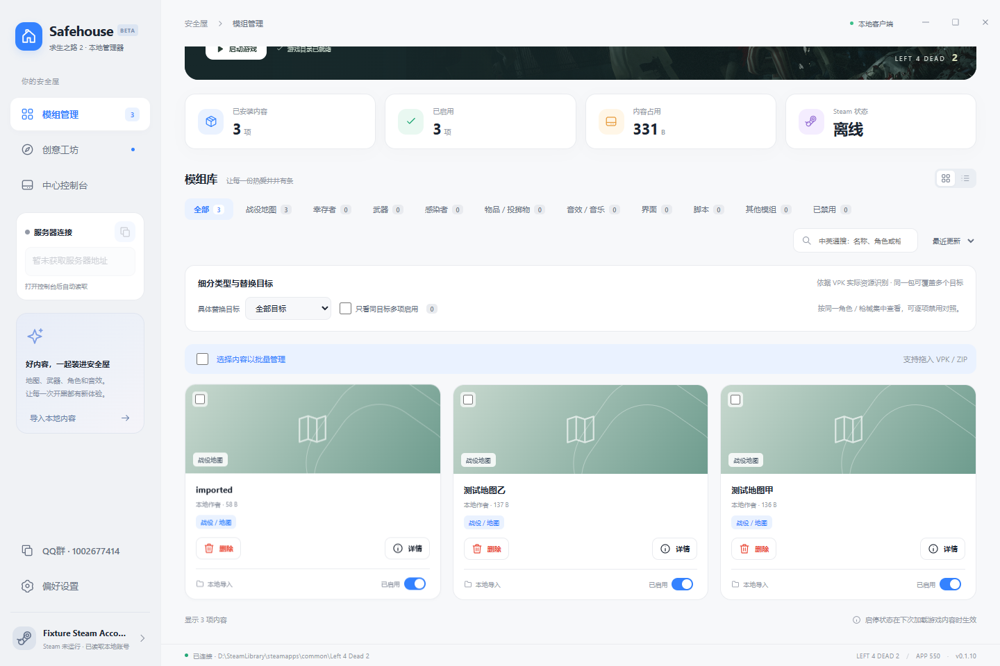

<div align="center">

# Safehouse · 安全屋

### 地图、角色、枪械，一起装进安全屋。

求生之路 2 的 Windows 桌面模组管理器。管理本地 VPK、逛创意工坊，也能接入自己的服务器控制台。

[](https://github.com/Z1og/Safehouse/releases/latest)
[](https://github.com/Z1og/Safehouse/releases/latest)
[](#交流群)

[下载客户端](https://github.com/Z1og/Safehouse/releases/latest) · [反馈问题](https://github.com/Z1og/Safehouse/issues) · [L4D2 服务器控制台](https://github.com/Z1og/L4D2-Control)

</div>



> 截图使用示例账号与临时测试内容，展示实际客户端界面；程序不附带这些模组或游戏本体。当前为 Beta，欢迎反馈。

## 它能做什么

| 功能 | 实际用法 |
| --- | --- |
| 模组管理 | 导入 VPK / ZIP，单项或批量启停；本地模组可移至回收站，保留导入源文件 |
| 工坊本地化 | 单项或勾选批量创建独立本地 VPK，取消订阅后继续保留使用 |
| 失败任务清理 | 单项删除失败记录；面板下载残留可同时移至回收站，不删除原始导入文件 |
| 具体替换分类 | 幸存者细分八名角色；武器细分手枪、冲锋枪、霰弹枪、步枪、狙击枪、近战及具体槽位 |
| 创意工坊 | 搜索、筛选、看详情，在客户端内订阅、下载、安装；取消订阅卸载工坊副本，保留已本地化的独立副本 |
| 我的收藏 | 独立本机收藏页，按角色、枪械细分筛选；移除收藏不会取消订阅或卸载 |
| 页码跳转 | 工坊与收藏支持点击页码、输入跳转；后台翻译不阻塞翻页 |
| 中英文搜索 | 内置角色 / 武器别名，中文也能匹配英文标题；在线翻译扩展更多关键词，失败时保留原词 |
| 本机 Steam 状态 | 自动读取本地账号；工坊操作使用本机正在登录的 Steam，无须在管理器重复登录 |
| 中心控制台 | 输入已有 L4D2-Control 面板地址，在桌面里操作；支持缩放、宽屏与面板直连文件下载 |
| 服务器连接 | 从当前面板读取真实游戏地址与端口，一键复制 `connect 地址:端口` |
| 安装与更新 | 普通用户安装版、快捷方式与卸载入口；客户端内检查、下载安装包，确认后重启安装 |
| 外观与交流 | 浅色 / 深色 / 跟随系统，QQ 群号一键复制，项目源码与更新入口 |

本项目与 [L4D2-Control](https://github.com/Z1og/L4D2-Control) 相互配合：**Safehouse 管本机，L4D2-Control 管服务器。** 只使用本地模组管理时，无须部署服务器面板。

## 下载与启动

1. 打开 [Releases](https://github.com/Z1og/Safehouse/releases/latest)，推荐下载 **`Safehouse-Setup-0.1.15-x64.exe` 安装版**。
2. 双击安装程序，选择安装目录；完成后通过桌面或开始菜单的 Safehouse 快捷方式启动。安装在当前 Windows 用户下，无需管理员权限。
3. 首次启动自动识别 Steam 游戏库；未识别时，到「偏好设置」手动选择 `Left 4 Dead 2` 目录。
4. 拖入 VPK / ZIP，或前往「创意工坊」订阅内容，即可开始使用。

支持 **Windows 10 / 11 x64**。玩家无需安装 Node.js，也无需以管理员身份运行。发布程序暂未代码签名，Windows 可能显示未知发布者提示。

需要便携版时，仍可下载 `Safehouse-0.1.15-win-x64.zip`，**完整解压**后双击根目录 `Safehouse.exe`；不要单独移动启动器或在压缩包内运行。

### 客户端内更新

「**偏好设置 → 应用更新**」点击「检查更新」，发现新版后点击「下载更新」。界面显示真实下载进度，可取消或重试；安装包通过 SHA-512 校验后，点击「重启并安装」。客户端先保存会话再退出，由安装程序完成升级。正在下载或安装模组时，需先完成或取消任务。普通关闭客户端不会自动安装，客户端也不会在后台自动下载。

从 **0.1.14 或更早版本** 首次升级，需要手动下载本次安装程序，因为旧版尚无更新入口。从 0.1.15 起，便携版也能在客户端下载安装版；希望继续使用便携版时，从发布页面下载新版 ZIP。

安装版和便携版共用 `%APPDATA%\Safehouse`，**原设置、收藏、面板 Cookie 与已加密记住的登录继续保留**；卸载安装版也保留此用户目录和游戏模组。更新时先退出旧窗口，不要删除数据目录。面板会话仍受服务器的过期、退出和密码变更影响；需要自动恢复时，可在面板登录页勾选“记住登录（仅本机加密保存）”。GitHub 网络不可用时，可重试或通过「发布页面」手动下载安装包。

## 模组如何管理

- **本地内容**：点击「导入内容」或拖放文件。支持单文件 VPK，以及包含 VPK 的 ZIP；同名不同内容不会覆盖。
- **启用 / 禁用**：修改游戏实际的 `left4dead2/addonlist.txt`，下次加载游戏内容时生效。
- **删除本地模组**：卡片或详情里点「删除」，确认后仅将已安装副本移至 Windows 回收站，原始导入文件保留。
- **工坊项目**：保持 Steam 运行，使用拥有求生之路 2 的账号。订阅后显示真实下载进度；取消订阅会停止对应任务并卸载本地副本。
- **我的收藏**：工坊卡片或详情点击「收藏」，在独立页面按类别、角色和具体枪械查找。收藏只是本机展示记录，不会自动订阅；移除收藏不影响已安装模组和订阅。收藏存于固定用户数据目录，更新后保留。
- **本地化保留**：在已安装的工坊卡片上点击「本地化」，或勾选多个 Mod 后点击「本地化所选」。管理器创建独立的 `addons/safehouse-local-工坊ID-内容摘要.vpk`，保留原启停状态并停用对应工坊副本，避免重复加载；一个工坊项目有多个 VPK 时一并处理。之后取消订阅、Steam 清理工坊文件或客户端升级，独立副本仍保留。副本不会自动跟随工坊更新，可正常启停、移至回收站。
- **失败任务**：面板直连失败或取消后，可点「删除文件及记录」清理残留至回收站并移除该条记录；本地导入或工坊任务点「删除记录」只删记录。正在下载或安装的任务须先结束。顶部「清理已结束」仍只清理历史，保留完整下载与已安装模组。
- **分类依据**：已安装包优先按 VPK 内实际模型、材质和脚本路径识别；工坊页面参考作者标签与替换说明，标题推测会单独标注。
- **同目标查看**：集中查看替换同一角色或枪械的内容，再逐项启停对照。这不是自动判定冲突或保证所有 Mod 兼容。

## 接入服务器控制台

「中心控制台」中填写自己的完整 HTTP / HTTPS 面板地址，连接并保存。新用户没有预设服务器；旧版本已保存的地址继续保留。

接入 [L4D2-Control](https://github.com/Z1og/L4D2-Control) 后，可以继续使用原面板的服务器管理功能。对应面板的「直连下载」可交由客户端传输，显示进度、取消、打开文件夹及安装入口；需要有效直链与相应服务可用。

从 0.1.14 起，面板的普通登录、授权登录表单可勾选 **“记住登录（仅本机加密保存）”**。登录成功后，账号和密码通过 Windows 当前用户的系统加密保存在固定用户目录；更新、更换 EXE 文件夹或面板服务重启后，如果原会话已失效，客户端使用保存的信息重新请求面板登录。未勾选时不保存密码；已有有效 Cookie 继续直接使用。服务器拒绝凭据时停止自动重试。

主动点击面板“退出登录”会同时清除当前面板保存的信息；工具栏“忘记登录”仅删除本机保存的账号信息。记录按完整协议、域名和端口隔离，不使用其他面板的账号。旧版本没有保存过的密码无法补回，首次使用此功能需手动登录并勾选一次。HTTP Basic 登录仍只在本次进程使用，不属于记住登录功能。

左侧服务器连接命令来自面板实际提供的游戏地址，而非面板网页地址；支持 IPv4、域名及带方括号的 IPv6。切换面板或失去连接后会清除旧命令。

## 已知边界

- 不提供游戏本体、破解、加速器、代理订阅或预装 Mod；不会要求输入 Steam 密码。
- 不支持 RAR / 7z / 裸 BSP / SourceMod 插件导入。分卷 VPK 不支持在客户端安装或删除。
- 单文件上限 2 GiB，ZIP 总解压上限 4 GiB；会检查包结构，不覆盖已有内容。下载地址和网络状况仍可能影响成功率。
- Steam 缓存只读。工坊必须由 Steam 账号拥有对应游戏并能正常访问服务；下载显示实际状态，不承诺绕过 Steam 限制。
- 界面为中文，社区内容可以翻译到所选语言。优先使用必应翻译，不可用时切换 Google；只发送搜索词或社区公开文字。成功的标题和详情分段显示，超时保留原文并提供「重试翻译」，始终可以切换查看原文。
- 应用更新来自 GitHub 正式发布，需要网络连通；不会静默自动安装。暂不支持云同步或 GameMaps 客户端接入，中心控制台里的功能由所接入面板提供。

## 交流群

**QQ 交流群：1002677414**

和 L4D2-Control 共用交流群，交流地图、Mod、开服经验和功能建议。客户端左下角点击群号即可复制，再到 QQ 搜索加入。

反馈问题请附上：客户端版本、复现步骤、报错截图，以及问题属于本地导入、工坊还是服务器面板。请勿公开账号密码、Cookie 或带签名的私人下载链接。

## 本地开发

需要 Node.js 22 或更新版本，当前开发与发布目标为 Windows x64。

```powershell
npm ci
npm test
npm start
```

```powershell
npm run smoke:renderer
npm run smoke
npm run smoke:taxonomy
npm run smoke:console-search
npm run smoke:panel-download
npm run smoke:console-login
npm run smoke:server-connection
npm run smoke:localization
npm run smoke:translation
npm run smoke:favorites
npm run smoke:updates
npm run licenses
npm run pack
```

构建需要 Zig，设置 `SAFEHOUSE_ZIG_BIN` 为本机 `zig.exe` 路径。发布输出位于仓库相邻的 `outputs/desktop`，同时包含安装 EXE、便携 ZIP、SHA-256 文件与客户端更新所需的 `latest.yml`。测试使用临时游戏目录；带 `live` 的手工集成测试会访问真实服务，不属于默认 `npm test`。隔离安装升级测试见开发文档。

详细结构、测试和恢复说明见 [开发文档](docs/DEVELOPMENT.md)。

## 项目来源与许可

© 2026 Z1og and original contributors.

原创部分采用 [Safehouse Non-Commercial License 1.0](LICENSE)：允许非商业使用，商业使用需事先取得授权。这是源码公开的非商业项目，不应描述为不受限制的开源许可。

第三方依赖、游戏资源和玩家 Mod 继续遵守各自许可，详见 [NOTICE.md](NOTICE.md) 与 [THIRD-PARTY-NOTICES.txt](THIRD-PARTY-NOTICES.txt)。界面视觉参考 Miuix，以 Electron 实现；与 Valve / Steam 无隶属关系。
